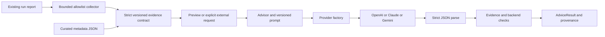

# AI integration architecture

Status: versioned advisory integration with report-driven failure diagnosis.

## Design and relationship to AdversaryGraph

AdversaryGraph uses a common asynchronous adapter, a provider factory and lazy SDK
imports. Unpacker follows that pattern without importing AdversaryGraph code,
settings, web application services or its ATT&CK-specific prompts. The application
owns the domain schema and evidence validation; providers only return text and usage.



There is no connection from an AI recommendation to an unpacker dispatcher. Advice
cannot mutate `UnpackResult`, set success, run commands or initiate emulation.
The existing `unpacker` command and orchestrator behavior remain unchanged.

## Components

| Module | Responsibility |
|---|---|
| `contracts.py` | Strict bounded input/output schemas, typed observations and advisory actions |
| `run_contracts.py` | Version 2 run records, independent comparison gates, grounded diagnostic steps |
| `collector.py` | Bounded regular-file report loading, strict JSON and metadata allowlist projection |
| `policy.py` | Per-run diagnostic capability checks and context-constrained provider schemas |
| `config.py` | Explicit provider/model/key selection; read-only dotenv loading |
| `providers.py` | Async protocol, lazy factory, OpenAI/Claude/Gemini adapters and normalized usage |
| `advisor.py` | Canonical evidence digest, one-call deadline, prompt, output/reference validation and safe errors |
| `cli.py` | Metadata-only entry point and offline exact-payload preview |

Provider calls use official endpoints, no tools, no file upload and no automatic
fallback. OpenAI requests schema-constrained JSON. Claude receives the schema in the
prompt; its response still must pass the same strict local parser. Gemini requests
JSON with a schema. Model selection and the OpenAI CLI default are described below;
provider acceptance and schema support depend on the chosen model. Raw provider responses and exception
bodies are never included in results or printed on errors.

## Configuration and credentials

Install only the selected provider extra in a managed environment:

```bash
pip install '1200km-unpacker[ai-openai]'
# alternatives: [ai-claude], [ai-gemini]; [ai] supports offline contracts/preview
```

The CLI accepts `--env-file`; nothing is auto-discovered from the home directory.
Use an operator-selected explicit credential file such as `/secure/provider.env`.
Do not infer permission to read another application's secrets. No keys belong in source control.
The loader uses dotenv parsing, not shell sourcing, and disables interpolation.
Only the selected provider's API key and model are retained. It does not change
`os.environ` or initialize any other provider.

The OpenAI CLI default is `gpt-6.1-sol`. An explicit `--model` overrides it.
Use `--model-from-env` to select `OPENAI_MODEL` from the process or explicit
env-file instead; this preserves access to the previous env-driven selection.
The shared credential file is not edited to change Unpacker's model.
Claude/Gemini continue using explicit `--model` or their provider MODEL variable.
The lower-level `AIConfig.load()` API remains explicitly configured: its precedence
is supplied model over process model variable over env-file model variable.
For credentials, process variable wins over env-file variable, including an empty
process value (which fails closed).

The selected model string is configuration, not proof of account availability.
Verify the chosen provider/model supports the requested response contract before
a separately authorized live call. This source update performs no live check.
Changing the model does not change prompt authority, validation gates, token/byte
budgets, timeout, provider endpoint or the unpacking/emulation configuration.

| Provider | Key variable | Model variable |
|---|---|---|
| `openai` | `OPENAI_API_KEY` | `OPENAI_MODEL` |
| `claude` | `ANTHROPIC_API_KEY` | `ANTHROPIC_MODEL` |
| `gemini` | `GEMINI_API_KEY` | `GEMINI_MODEL` |

If AdversaryGraph has no `ANTHROPIC_MODEL`, pass `--model` explicitly. A model name
in another app's source defaults is not assumed to be available to this account.

## Input and disclosure boundary

Version 1 `EvidenceBundle` remains supported. The example is synthetic; it is not
proof that UPX is installed on a given host. Version 2 `RunEvidenceBundle` can be
constructed from an existing `report.json` with `--from-report`. The collector
never opens the original specimen, an artifact, an included path, or another file.

Allowed observations are packing-signal enums, backend-status enums,
validation-status enums, and bounded entropy/import-count/page-coverage metrics.
No filenames, raw strings, disassembly, paths, binaries, logs or free-form notes are
accepted. Unknown fields and invalid enum values are rejected. Evidence IDs also
leave the machine; use opaque IDs, never identifiers carrying private sample names.
Even structural metadata may be sensitive; use preview and the applicable data policy.

Run from the checkout without installing anything:

```bash
PYTHONPATH=src python -m unpacker.ai.cli docs/ai-evidence-example.json --preview
PYTHONPATH=src python -m unpacker.ai.cli docs/ai-evidence-example.json \
  --provider openai --env-file /secure/provider.env
# Inspect exactly what a real run would disclose, offline:
PYTHONPATH=src python -m unpacker.ai.cli /path/to/run/report.json --from-report --preview
# Explicitly request external diagnosis of that allowlisted metadata:
PYTHONPATH=src python -m unpacker.ai.cli /path/to/run/report.json --from-report \
  --provider openai --env-file /secure/provider.env
```

After package installation the equivalent entry point is `unpacker-ai`.
Preview needs no key, does not load dotenv or instantiate a provider, and makes no
network request. An ordinary invocation sends the validated metadata to the selected
provider. The key is passed to that provider SDK only. Provider data-retention rules
remain an operator deployment decision; this code makes no universal retention claim.

## Response contract and authority

Advice has hypotheses with evidence IDs, a bounded summary, and one recommendation:
`review_backend`, `gather_evidence` or `abstain`. There is no confidence probability,
execution action, shell, arbitrary URL or generated code field. Extra fields such as
`success`, `execute`, or `api_key` invalidate the response. Referenced IDs must exist.
A backend review must cite evidence and name an available, format-compatible backend.
Readiness is supplied by the caller and is not proof of sandbox readiness.

The response envelope records provider/model, `advisor-1` prompt version, canonical
evidence SHA-256, elapsed time, token usage when available, and a typed status/error.
The digest includes the complete exported bundle; it is not a sample hash.
No raw response is saved. Summary prose is still a model hypothesis, not a validator.
Reference existence checks cannot prove that a cited observation semantically supports
every sentence. Reports consuming advice must retain this distinction.

One analysis makes at most one provider request, with SDK retry disabled where
configured and an outer async deadline. Defaults: 45 seconds, 1,500 output tokens,
32 KiB canonical input and 32 KiB accepted response. Provider output-token limits
control generation; the response-byte check occurs after SDK receipt and is not an
HTTP transport memory quota. No dollar-cost guarantee is inferred from token counts.

Errors are stable codes, e.g. `provider_timeout`, `provider_refusal`,
`incomplete_response`, `invalid_response_schema`, `unknown_evidence_reference`,
`backend_not_ready_or_compatible`, `provider_error`. SDK exception text is withheld.
CLI: exit 0 for advice/preview, 1 for an unavailable/invalid advice result, 2 for
input/configuration/initialization errors. Input/schema failures never echo raw data.

## Report-driven diagnosis (schema version 2)

The report collector reads at most 2 MiB from a regular file, rejects symlinks,
duplicate JSON keys and nonfinite numbers, and accepts at most 32 layers. Exported
canonical evidence remains limited to 32 KiB. IDs are generated as `layer.1` and
`signal.1`; report names and IDs are not reused. A report is an untrusted assertion,
not an authenticated proof. Local output records its SHA-256 and collector version;
this provenance and the report itself are never sent to the provider.

The allowlist includes parsed format/architecture, exact section-name signal enums,
backend family, reported outcome, validation status, seven independent reference
comparison gates, rejected-handoff count, curated runtime-gap names, and classified
guest fault/message enums. Partial runs also carry deduplicated `partial_causes`:
inferred entry execute permission, omitted noncontiguous allocations, inferred
headers, approximated instruction cache, recovered erased import names, modeled
interactive response, unreconstructed embedded VFS/TLS, or `other`. These labels
come only from exact known report diagnostics. Unknown notes become `other`;
raw warning text is never exported. Causes require an explicit partial outcome
and do not upgrade it when the comparison gates pass.
Raw logs, paths, sample hashes, guest addresses, code,
memory, strings and arbitrary API names are discarded. A native UPX integrity
result is not relabeled as a section-name signal. Detector confidence is not
converted into entropy. Old reports without architecture export `unknown`.
New reports derive architecture from consistent machine/class fields inside the
existing static analysis worker. No LLM guesses architecture.

The model can return a bounded diagnosis with explicit limitations and the following
diagnostic steps. Local validation checks each step and diagnosis against the cited
run, including rejecting invented IDs and citations that only name an unrelated signal.

| Diagnostic step | Required reported evidence |
|---|---|
| `inspect_imports` | Failed imports, descriptor or loader-ready IAT gate |
| `trace_handoff` | Rejected candidate or failed entry gate |
| `trace_decoder_input` | Exact guest `Corrupt Data!` classification |
| `review_guest_api` | Recorded unsupported API |
| `profile_decoder` | Timeout status |
| `check_reference` | Reference comparison has not been established |
| `review_partial_scope` | Explicit partial outcome |
| `compare_executable_bytes` | Failed executable-byte gate |
| `inspect_guest_fault` | Recorded unmapped read/fetch, protection fault, invalid instruction or CPU exception |

`check_reference` means checking availability/provenance, not asserting no reference
exists. Reported corruption is not proof of corruption; a CPU exception does not
establish the missing CPU/SEH feature. An all-passed gate set does not upgrade a
partial result. A status string does not create missing gates or backend readiness.
There are no execute/patch/download actions or automatic retries. Model explanation
text remains unverified and is never parsed as a command. The prompt explicitly
rejects bypassing checks, dummy API success and indiscriminate budget increases.
The provider schema is narrowed to supported action/category enums and existing
evidence IDs for this request. A compact route table in the system prompt lists
which actions each run supports. Local checks still reject a wrong citation even
if an action is supported by another run. If no routes exist, only abstention with
an empty step list is requested. These constraints reduce invalid proposals; they
do not prove model accuracy or authenticate the source report.
The envelope uses `run-advisor-2.2` and preserves provider, model, timing, usage,
the actual exported metadata digest, and separate request-schema/system-prompt
SHA-256 digests. The model cannot grant full recovery.

## Test strategy

Offline tests use fake providers and synthetic metadata. They cover disclosure limits,
strict parsing, fabricated evidence, unavailable/incompatible recommendations,
timeouts, sanitized provider errors, env precedence, key representations and preview
without credentials. Provider adapter contract tests use fake SDK responses. No test
requires a key or executes a sample. AI tests are optional when Pydantic is absent;
CI has a separate job that installs AI extras and runs them with network-independent
fakes and plugin autoload disabled.

Live checks must use synthetic metadata, a selected provider and explicit configured
model. Never use a real sample as a connection test. Live smoke success establishes
only connectivity and schema handling for that model, not extraction quality.

## Next architecture gates

1. Add a held-out benign evaluation set measuring useful diagnosis and unsupported
   claims against deterministic triage. Contract tests and a connectivity smoke
   check do not measure unpacking improvement or diagnostic accuracy.
2. Add typed, bounded trace requests to an existing isolated worker, including a
   cost/request budget and auditable human review. A proposed action must still
   pass policy and worker capability checks before any execution.
3. Evaluate compiler/packer variants and independently reproduced fixtures before
   any diagnostic heuristic becomes an automatic decoding/reconstruction rule.

Local/OpenAI-compatible endpoints, additional providers, retrieval, selected-content
exports, streaming and autonomous loops require separate reviewed contracts. They
are not silently enabled by reading AdversaryGraph's environment settings.

Reference: [OpenAI structured outputs](https://developers.openai.com/api/docs/guides/structured-outputs).
