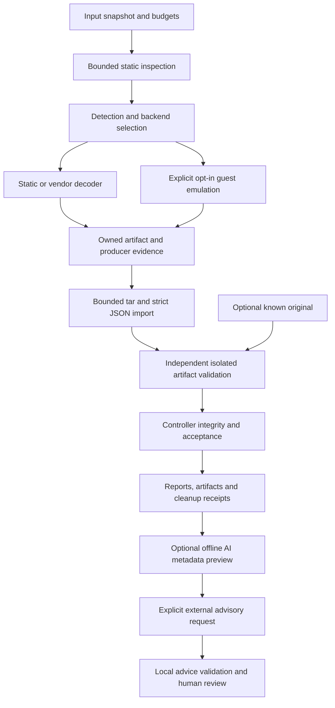

# Architecture and trust boundaries

AI has no execution/acceptance edge. Analysis does not see the known original.
A worker report is an untrusted assertion until independently checked.

## Components

|Component|Responsibility|
|---|---|
|`cli.py`, `types.py`, `configuration.py`|Typed reports, explicit options and bounded YAML settings|
|`detector/`|Format/architecture, signatures, sections, entropy and heuristic signals|
|`orchestrator.py`|Layering, dispatch, global budgets and stop reasons|
|`unpackers/`|Static/vendor handlers and opt-in emulation adapters|
|`static_worker.py`, `backend_worker.py`, `process.py`|Finite parsing/backend subprocesses, signals and owned cleanup|
|`pe_rebuilder/`, `reconstruction.py`, `validation.py`|Bounded PE reconstruction and import/IAT/reference gates|
|`guest_*`, `winapi_model.py`, `crt_*`|Selected deterministic API, export, protection, file, CRT and exception models|
|`sandbox_cli.py`, `sandbox_payload.py`|Networkless namespaces, selected mounts and bounded evidence export|
|`worker_cli.py`, `worker_payload.py`|Transient cgroup, observed limits and group cleanup|
|`evidence_archive.py`, `report_integrity.py`|Transport/path/entry/schema/hash checks and acceptance|
|`ai/`|Curated evidence, lazy provider factory and constrained advice contracts|

## Extraction and reconstruction

Static parsing has a hard deadline. Input, per-output, aggregate bytes and entry
counts are checked; each attempt owns new output paths. UPX is invoked as a
vendor decoder, not as the specimen. ELF paths cover specific notes, wrappers
and payload formats rather than arbitrary Linux process emulation. Qiling
needs an explicitly supplied rootfs; it is not a configured universal fallback.

The PE32 path wraps Unipacker with the maintained Unicorn core/binding.
Selected models cover virtual self-file reads, attributes, heap/protection,
CRT operations, callbacks, module/export views, message/display primitives and
x86 exception cases. Virtual file paths never fall back to host reads.
Modeled Win32 behavior does not execute host Windows libraries.

Observed writes/handoffs, live image bounds, executable entry mapping and
import provenance constrain reconstruction. IAT searches reject ambiguity
unless bounded reachable-code evidence resolves it. Retained imports, erased
names and bound-import recovery have explicit gates. Missing bytes, inferred
permissions/headers, noncontiguous allocations and wrapper behavior remain
partial evidence. A parsable dump or moved entry point is not completeness.

SEH/API models are bounded, not full Windows debugger, CLR, GUI or OS semantics.
Unknown execution semantics, malformed imports, unsupported registrations and
event-budget exhaustion stop explicitly; no dummy success handle substitutes
for missing behavior. Three legacy raw Windows DLLs and three LDLL caches are
still dependency data; their redistribution rights are not implied by package
GPL metadata. Exclusion/source-only prototypes are not adopted into RC12.

## Isolation layers

1. Process supervision bounds time/outputs and cleanup; it is not an OS sandbox.
2. Patched unprivileged Bubblewrap >=0.12.0 unshares user/mount/network/PID/IPC/UTS,
   drops capabilities, enables no-new-privileges, mounts selected input/runtime
   readonly and bounds tmpfs output. Base site/dist-package trees are masked.
3. A transient cgroup limits group memory, swap, tasks and CPU, applies a finite
   watchdog and cleans descendants that create a new session with `setsid`.
4. A separately accepted disposable VM is the intended outer hostile boundary.
   The experimental VM has only passed a benign core test; GDS and full-worker
   acceptance remain open.

The approved local AppArmor model grants setup permissions to the immutable
launcher and stacks a capability-denying profile on executed children. Package
installation does not silently apply that host policy. Denials require diagnosis,
not a weaker fallback. Source/package tests do not attest target isolation.

## Evidence contract

Tar import rejects traversal, links, special members, normalized duplicates,
NUL/malformed data and byte/entry overflow. Implied directories count. JSON
rejects duplicate keys, nonfinite/overflowing numbers and nesting beyond 64.
Controller checks input snapshots, report relationships and actual artifact
bytes/hashes/paths before separately jailed validation.

The seven PE reference gates are executable bytes, entry RVA, entry mapping,
imports, loader-ready IAT, import descriptors and machine type. They are finite
comparisons, not behavioral equivalence. Partial/error evidence can disqualify
an artifact even when all seven gates pass. Signatures, confidence, an LLM,
file existence or a producer `success` field cannot establish recovery.

## Packaging and remaining boundaries

The project wheel contains Python source/metadata, not corpus specimens,
Windows resources, VM disks or native dependency wheels. Hashes establish
bytes, not legal rights or absence of defects. Registry scans are not native/OS
security audits. Hostile VM ingress/export, validator separation, aggregate VM
disk quotas, sealed reset lifecycle, protected CI and retention/access policy
remain open gates. The benign serial proof is not a general authenticated
production transport.
